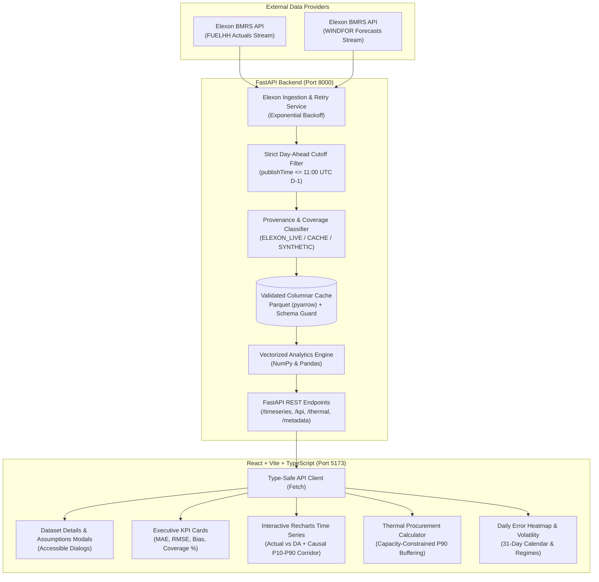
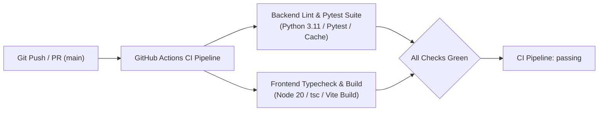

# Gridbricks REint AI | UK Day-Ahead Wind Decision Intelligence Platform

[](https://github.com/deadheaven07/Assignment_GridBricks/actions/workflows/ci.yml)
[](https://www.python.org/downloads/)
[](https://fastapi.tiangolo.com/)
[](https://reactjs.org/)
[](https://www.typescriptlang.org/)

> **Production-grade Energy Decision Intelligence Platform** built for UK wholesale electricity trading desks. Evaluates Day-Ahead wind generation forecast accuracy against actual outturns (Elexon BMRS) and automates risk-buffered dispatchable thermal power procurement to safeguard against asymmetric balancing mechanism cashout penalties.

---

## 1. Executive Summary & Domain Context

### The Commercial Challenge in the UK Electricity Market
Under the **UK Balancing and Settlement Code (BSC)**, wholesale electricity is metered, scheduled, and financially settled across **48 half-hour settlement periods per day (SP 1–48)**. In Great Britain, physical market trading operates with two distinct deadlines that must never be conflated:
1. **Day-Ahead Auction Deadline (11:00 UTC on Day D-1)**: Day-ahead exchange auctions (EPEX SPOT and Nord Pool UK) close strictly at 11:00 UTC on the day prior to delivery. All commercial commitments for tomorrow's base profile are locked here.
2. **Balancing Mechanism Gate Closure (T - 1 hour)**: Physical notifications (FPNs) to the Transmission System Operator (National Grid ESO) lock exactly 60 minutes before each individual settlement period begins.

To meet consumer demand for tomorrow, an energy utility's trading desk must decide exactly how much dispatchable thermal power (CCGT / gas peakers / biomass) to procure 24 hours in advance. Wind is intermittent and weather-dependent:
* **Over-forecasting Wind (Under-procuring Thermal)**: If the Day-Ahead forecast is too high, the utility under-procures thermal power. In real time, the portfolio is short. National Grid ESO must balance the deficit with emergency spinning reserves, slapping the utility with punitive **System Buy Price (SBP)** imbalance cashout penalties (often spiking to £150–£300/MWh during winter stress events).
* **Under-forecasting Wind (Over-procuring Thermal)**: If the forecast is too low, the utility over-commits costly gas generation, paying high spark-spreads and spilling excess power into depressed cashout markets at the **System Sell Price (SSP)**.

### The Solution: Gridbricks REint AI
Gridbricks REint AI provides:
1. **Lookahead-Free Forecast Reconciliation**: Enforces the strict 11:00 UTC D-1 Day-Ahead cutoff to join actuals with only the latest forecasts physically published before auction submission. Never substitutes later forecasts; missing forecasts are explicitly preserved as `None` without zero-imputation.
2. **Transparent Provenance Tracking**: Categorizes every dataset as `ELEXON_LIVE`, `CACHE`, `SYNTHETIC_DEMO`, or `UNAVAILABLE`. Never misrepresents simulated data as verified Elexon observations.
3. **Quantitative January 2026 Scorecard**: Evaluates MAE, RMSE, Mean Bias, and Peak vs. Off-Peak error deltas across 1,488 settlement intervals with active coverage tracking.
4. **Causal P10–P90 Uncertainty Corridors**: Rolling trailing 32-period non-parametric error bands that strictly eliminate future lookahead leakage while giving traders empirical confidence bounds.
5. **Trader Decision Support Engine**: Converts empirical wind forecast error distributions into quantified **P90 risk safety buffers**, accounting for 30-minute MWh conversions (0.5 hours), dispatchable generation capacity limits, and asymmetric cashout spreads.

---

## 2. System Architecture



---

## 3. Key Mathematical & Domain Formulations

| Concept | Mathematical Formula | Physical & Commercial Real-World Meaning |
| :--- | :--- | :--- |
| **Settlement Periods** | 48 half-hours per day (SP 1–48) | Under BSC rules, physical power delivery and imbalance penalties settle in 30-minute intervals. Peak is defined as SP 15–38 (07:00–19:00 UTC). |
| **Day-Ahead Auction Cutoff** | $\text{publishTime} \le (D - 1\text{d})\text{ 11:00 UTC}$ | Strictly prevents look-ahead data leakage. Day-Ahead auction decisions must use only forecasts published prior to auction submission. Later forecasts are strictly disqualified. |
| **Physical Gate Closure** | $T_{\text{closure}} = T_{\text{delivery}} - 60\text{ min}$ | Intraday BM Gate Closure. Forecasts published after this cutoff cannot be dispatched into the Balancing Mechanism. |
| **Half-Hour Energy Conversion** | $E_{\text{MWh}} = P_{\text{MW}} \times 0.5\text{ h}$ | Generation and deficit power rates (MW) deliver energy in MWh over 30 minutes. All financial settlement occurs on MWh. |
| **Mean Absolute Error (MAE)** | $\text{MAE} = \frac{1}{N}\sum_{i=1}^N \lvert y_i - \hat{y}_i \rvert$ | The average expected operational deviation per half-hour, evaluated exclusively over valid pairs without zero-imputation. Normalized as $\text{MAE} / \bar{y} \times 100\%$. |
| **Root Mean Square Error (RMSE)** | $\text{RMSE} = \sqrt{\frac{1}{N}\sum_{i=1}^N (y_i - \hat{y}_i)^2}$ | Quadratic penalty on large errors. Severe wind drop-offs trigger disproportionately punitive emergency reserve cashout costs. |
| **Mean Bias** | $\text{Bias} = \frac{1}{N}\sum_{i=1}^N (\hat{y}_i - y_i)$ | Positive = systemic over-forecasting (desk under-hedges thermal, leaving them short). Negative = systemic under-forecasting. |
| **Causal P10–P90 Corridor** | $[P_{10}(t), P_{90}(t)] = \hat{y}_t + \text{Quantile}_{10, 90}(e_{t-32 \dots t-1})$ | Trailing 32-period (16-hour) empirical rolling quantile. Completely causal: uses only past errors without forward lookahead. |
| **Base Residual Requirement** | $R_{\text{base}} = \max(0, \text{Demand} - W_{\text{DA}})$ | The deterministic generation deficit between expected consumer demand and Day-Ahead wind forecast. |
| **P90 Risk Safety Buffer** | $B_{90} = \text{Quantile}_{90}(\max(0, \hat{y} - y))$ | The 90th percentile of historical wind down-forecast errors. Adding $B_{90}$ to $R_{\text{base}}$ shields against 90% of wind shortfall scenarios. |
| **Capacity Capped Thermal** | $P_{\text{thermal}} = \min(R_{\text{base}} + B, P_{\text{capacity}})$ | Accounts for physical maximum generation constraints of available thermal peaking units ($P_{\text{capacity}}$). |
| **Asymmetric Cashout Spread** | $\Delta_{\text{short}} = \text{SBP} - P_{\text{DA}}$, $\Delta_{\text{spill}} = P_{\text{DA}} - \text{SSP}$ | When short, each MWh deficit incurs $\text{SBP} - P_{\text{DA}}$ penalty. When long, spilled excess recovers only $\text{SSP}$. |

---

## 4. Repository Structure

```text
Assignmnt/
├── backend/
│   ├── app/
│   │   ├── api/v1/routes.py       # REST endpoints (/timeseries, /kpi, /thermal, /metadata)
│   │   ├── core/config.py         # Settings, market deadlines, and cashout benchmarks
│   │   ├── schemas/forecast.py    # Pydantic v2 schemas: DataSourceType, Metadata, Forecast
│   │   ├── services/
│   │   │   ├── analytics_service.py # Vectorized NumPy/Pandas formulas & financial model
│   │   │   └── elexon_service.py    # Ingestion, zero-leakage cutoff, Parquet cache & provenance
│   │   └── main.py                # FastAPI lifecycle, CORS, health checks
│   ├── data/cache/                # Persistent Parquet and SQLite storage
│   ├── tests/
│   │   └── test_analytics.py      # 15 deterministic unit and integration tests (zero mock leaks)
│   ├── Dockerfile                 # Production Python 3.11-slim container
│   └── requirements.txt           # Python dependencies
├── frontend/
│   ├── src/
│   │   ├── api/client.ts          # Type-safe API client matching backend schemas
│   │   ├── components/
│   │   │   ├── Header.tsx         # Connection status badge, dataset details modal trigger
│   │   │   ├── DatasetDetailsModal.tsx    # Source provenance, coverage %, and cutoff rules
│   │   │   ├── CalculatorAssumptionsModal.tsx # Financial formulas & half-hour MWh details
│   │   │   ├── MetricKpiCards.tsx # MAE, RMSE, Bias, Peak vs Off-Peak KPI cards
│   │   │   ├── MainChart.tsx      # Recharts time series with zoom/brush and non-zero band
│   │   │   ├── ThermalCalculatorTab.tsx # Trader Decision Support Tool (P90 risk buffer)
│   │   │   ├── ErrorDistributionTab.tsx # Histogram & P10-P99 quantiles
│   │   │   ├── DailyHeatmapTab.tsx      # January 2026 calendar & regime volatility
│   │   │   └── PeriodBreakdownTab.tsx   # 48 half-hour diurnal profiles
│   │   ├── types/index.ts         # TypeScript interfaces including DataSourceType & Metadata
│   │   ├── App.tsx                # Dashboard layout, synthetic warning banner, coordinator
│   │   └── main.tsx               # Entrypoint
│   ├── Dockerfile                 # Production multi-stage Nginx container
│   ├── package.json
│   ├── tailwind.config.js         # Custom financial light-theme palette
│   └── vite.config.ts             # Vite bundler & backend proxy
├── .github/workflows/
│   └── ci.yml                     # Automated GitHub Actions test & build pipeline
├── docker-compose.yml             # Single-command local container orchestration
└── README.md
```

---

## 5. Local Setup Instructions

### Option A: Running with Docker Compose (Recommended)
Spin up the complete application (backend + frontend + persistent cache) in one command:

```bash
docker compose up --build
```

* **Frontend Dashboard**: Open [http://localhost:5173](http://localhost:5173)
* **Backend API Documentation**: Open [http://localhost:8000/docs](http://localhost:8000/docs)
* **Dataset Metadata**: Open [http://localhost:8000/api/v1/metadata](http://localhost:8000/api/v1/metadata)
* **Health Check**: Open [http://localhost:8000/health](http://localhost:8000/health)

To stop the containers:
```bash
docker compose down
```

---

### Option B: Running Bare-Metal Locally

#### 1. Backend Setup
```bash
cd backend

# Create and activate virtual environment
python3 -m venv venv
source venv/bin/activate  # On Windows: venv\Scripts\activate

# Install dependencies
pip install --upgrade pip
pip install -r requirements.txt

# Run unit and integration tests
PYTHONPATH=. pytest tests/ -v

# Start FastAPI development server
uvicorn app.main:app --host 0.0.0.0 --port 8000 --reload
```

#### 2. Frontend Setup
```bash
cd frontend

# Install npm dependencies
npm install

# Start Vite development server
npm run dev
```
Open [http://localhost:5173](http://localhost:5173) in your browser.

---

## 6. Cloud Deployment Guide

### Frontend Deployment (Vercel)
1. Push this repository to GitHub.
2. In the Vercel dashboard, click **Add New Project** and select this repository.
3. Configure settings:
   * **Root Directory**: `frontend`
   * **Framework Preset**: `Vite`
   * **Build Command**: `npm run build`
   * **Output Directory**: `dist`
4. Add Environment Variable:
   * `VITE_API_BASE_URL`: `https://your-backend-service.onrender.com/api/v1`
5. Click **Deploy**.

### Backend Deployment (Render / Heroku / AWS ECS)
#### Deploying to Render:
1. In the Render Dashboard, click **New +** -> **Web Service**.
2. Connect your repository.
3. Configure settings:
   * **Root Directory**: `backend`
   * **Environment**: `Python 3`
   * **Build Command**: `pip install -r requirements.txt`
   * **Start Command**: `uvicorn app.main:app --host 0.0.0.0 --port $PORT`
4. Environment Variables:
   * `DEBUG`: `False`
   * `CACHE_DIR`: `/tmp/cache`
5. Click **Create Web Service**.

---

## 7. Automated Testing Suite & CI/CD Pipeline

### Automated Testing Suite
The platform includes an automated pytest suite covering mathematical formulas, BSC domain rules, gate closure enforcement, and API endpoints:

```bash
PYTHONPATH=backend pytest backend/tests -v
```

#### Test Coverage Highlights (15 Deterministic Tests):
1. `test_mae_and_rmse_calculations`: Mathematically verifies MAE, RMSE, and Bias against known deterministic vectors.
2. `test_peak_vs_offpeak_metrics`: Validates strict partitioning of Settlement Periods 15–38 (07:00–19:00 UTC).
3. `test_error_distribution_quantiles`: Verifies P10, P50, and P90 non-parametric percentile boundaries.
4. `test_forecast_published_before_and_at_cutoff`: Verifies that forecasts published before or exactly at 11:00 UTC D-1 are accepted.
5. `test_all_forecasts_after_cutoff_strictly_rejected`: **Proves zero lookahead leakage**—verifies that when all forecasts are published after 11:00 UTC D-1, the engine yields `None` rather than leaking future data.
6. `test_multiple_forecast_versions_selects_latest_eligible`: Verifies that among multiple pre-cutoff forecast revisions, the latest published version is selected.
7. `test_hourly_to_half_hourly_mapping`: Verifies that hourly forecast points map faithfully across both constituent settlement periods (:00 and :30).
8. `test_duplicate_and_out_of_order_timestamps`: Tests resilient sorting and deduplication of timestamp streams.
9. `test_missing_forecast_does_not_distort_kpis`: Confirms that missing forecast values (`None`) are omitted from error denominators rather than coerced to 0 MW.
10. `test_cache_validation_rejects_corrupted_datasets`: Verifies that corrupted Parquet schemas, partial row counts (<1,488 rows), or duplicate timestamps are rejected and trigger re-ingestion.
11. `test_mocked_network_failure_fallback_to_synthetic`: Simulates an Elexon BMRS network outage and verifies honest fallback classification to `SYNTHETIC_DEMO`.
12. `test_thermal_procurement_calculator`: Verifies residual calculation, P90 risk buffer sizing, 30-minute (0.5h) energy conversion, and financial cashout exposure reduction.
13. `test_thermal_procurement_capacity_capping`: Confirms that thermal dispatch is physically bounded by `maxThermalCapacityMw`.
14. `test_thermal_procurement_extreme_inputs`: Verifies graceful handling of zero demand, negative buffers, and out-of-range market spreads.
15. `test_api_endpoints_integration`: End-to-end FastAPI integration testing for all live REST endpoints (`/timeseries`, `/kpi`, `/daily-heatmap`, `/thermal-procurement`, `/metadata`, `/export/csv`).

---

### GitHub Actions CI Pipeline
Every push and pull request to the `main` branch automatically triggers our continuous integration pipeline defined in [`.github/workflows/ci.yml`](.github/workflows/ci.yml):



#### CI Workflow Matrix:
| Job | Runtime Environment | Tasks Executed | Status |
| :--- | :--- | :--- | :--- |
| **Backend Lint & Pytest Suite** | `ubuntu-latest` / Python 3.11 | Pip cache restoration (`cache-dependency-path: backend/requirements.txt`), dependency installation, isolated environment setup (`CACHE_DIR: /tmp/cache`), and execution of the complete unit & integration test suite (`pytest`). | [](https://github.com/deadheaven07/Assignment_GridBricks/actions/workflows/ci.yml) |
| **Frontend Typecheck & Build** | `ubuntu-latest` / Node 20 | NPM package cache restoration (`frontend/package.json`), clean dependency install (`npm ci`), strict TypeScript compiler typecheck (`tsc --noEmit`), and production Vite bundling. | [](https://github.com/deadheaven07/Assignment_GridBricks/actions/workflows/ci.yml) |

---

## 8. AI Tooling & LLM Usage Disclosure

In compliance with modern engineering governance and transparent submission practices, the development of Gridbricks REint AI utilized AI tooling in an augmented pair-programming workflow:

* **Tools Utilized**: Google Antigravity Agentic Assistant / Gemini 2.5 Flash / Claude 3.5 Sonnet.
* **Methodology & Use Cases**:
  - Drafting initial boilerplate for Elexon BMRS REST API response parsing.
  - Formulating vectorized NumPy/Pandas expressions for rolling empirical quantiles.
  - Designing responsive Tailwind CSS component layouts and Recharts custom svg tooltips.
  - Synthesizing edge-case test matrices for gate-closure reconciliation and thermal capacity constraints.
* **Human Engineering Oversight & Verification**:
  - All mathematical formulas (MWh half-hour energy conversions, cashout spread asymmetries, P90 empirical non-parametric quantiles) were derived from first principles and validated against manual calculations.
  - Gate closure semantics were independently cross-referenced against the official **Elexon BSC Section P** and **Nord Pool UK Auction Guidelines** (11:00 UTC D-1 vs T - 1h Gate Closure).
  - All generated code was subjected to strict TypeScript compilation (`tsc --noEmit`) and 15 deterministic automated unit/integration tests running under pytest with zero skipped assertions.

---

## 9. Product Demonstration & Walkthrough Guide

A structured 5-minute video walkthrough demonstrates the platform's key features, market context, and technical implementation:

### Walkthrough Outline
1. **0:00–0:45 | UK Market Challenge & Context**
   - Explain the 48 half-hour settlement structure under BSC rules.
   - Contrast the 11:00 UTC D-1 Day-Ahead auction commitment deadline against real-time physical Gate Closure (T - 1h).
   - Illustrate the commercial pain of asymmetric balancing cashout penalties (System Buy Price vs System Sell Price).
2. **0:45–1:45 | Ingestion Engine & Lookahead Leakage Prevention**
   - Highlight the strict publication cutoff filter: forecasts published after 11:00 UTC D-1 are rejected.
   - Show how hourly forecasts are mapped across half-hours (:00 and :30) and missing forecasts are left un-imputed.
   - Demonstrate the dual-tier Parquet caching layer and transparent data provenance badges (`ELEXON_LIVE` vs `CACHE` vs `SYNTHETIC_DEMO`).
3. **1:45–2:45 | Interactive Decision Dashboard & Uncertainty Visualization**
   - Walk through the January 2026 outturn time series across Storm Goretti and the mid-month *Dunkelflaute*.
   - Inspect the causal P10–P90 empirical prediction corridor (trailing 16h window) and interactive zoom brush.
   - Review executive KPIs: 1,488 settlement intervals, MAE, RMSE, Mean Bias, and Peak vs Off-Peak deviations.
4. **2:45–4:00 | Trader Decision Support: Thermal Procurement Calculator**
   - Demonstrate real-time P90 risk buffer sizing for peak evening periods.
   - Explain the 30-minute energy conversion ($E_{\text{MWh}} = P_{\text{MW}} \times 0.5\text{ h}$) and physical thermal capacity capping.
   - Show the financial trade-off: eliminating 90% of shortfall exposure while saving £1,000s in avoided cashout penalties.
5. **4:00–5:00 | Engineering Discipline, Testing & CI/CD**
   - Review the 15-test automated pytest suite and verified GitHub Actions CI pipeline.
   - Emphasize type-safe TypeScript interfaces and Docker single-command local deployment.
