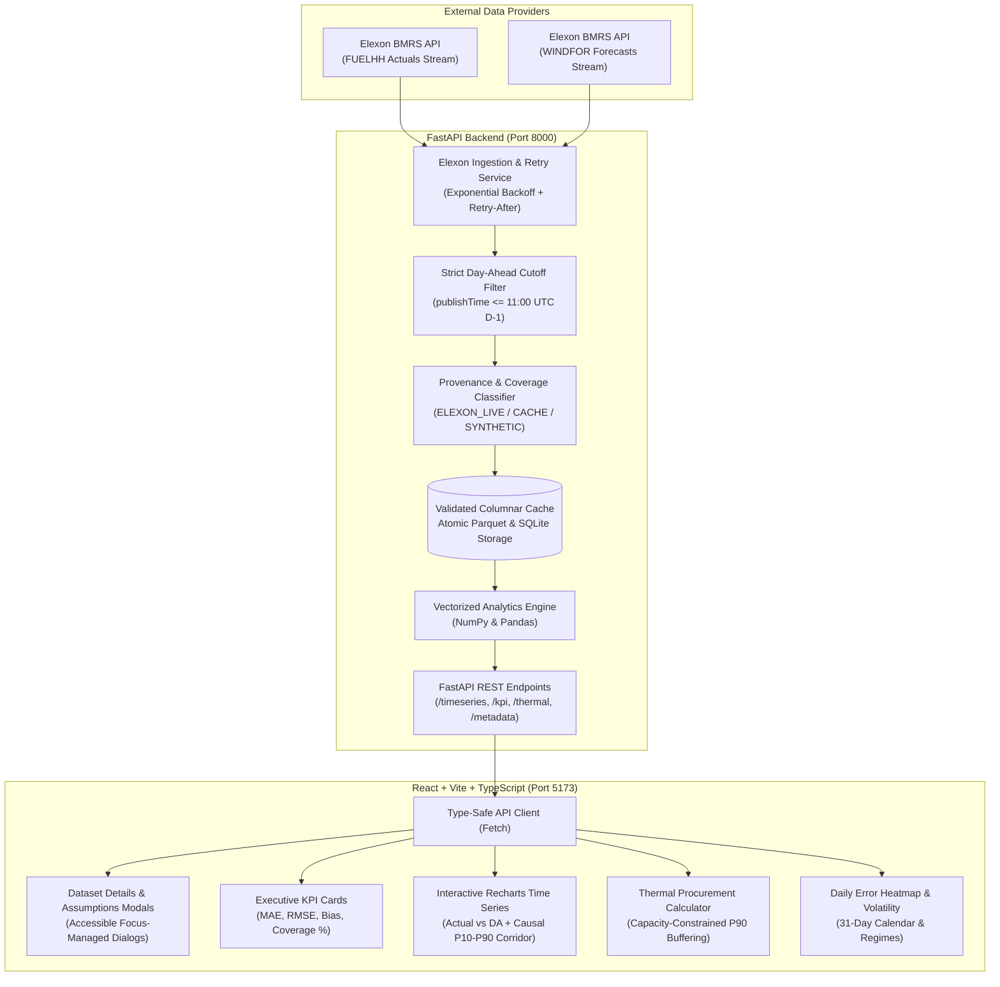
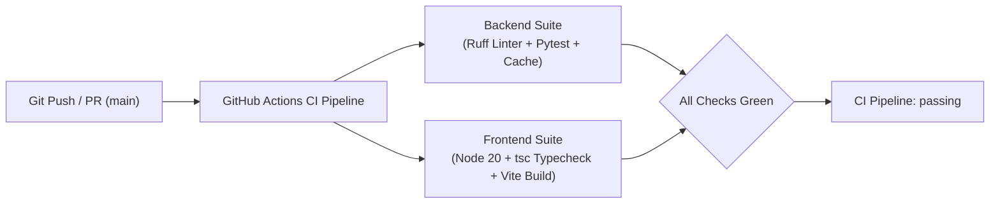

# Gridbricks REint AI | UK Day-Ahead Wind Decision Intelligence Platform

[](https://github.com/deadheaven07/gb-uk-wind-eval/actions/workflows/ci.yml)
[](https://www.python.org/downloads/)
[](https://fastapi.tiangolo.com/)
[](https://reactjs.org/)
[](https://www.typescriptlang.org/)
[](https://github.com/astral-sh/ruff)
[](https://assignment-grid-bricks.vercel.app/)
[](https://gridbricks-reint-backend.onrender.com/health)
[](https://www.youtube.com/watch?v=90gMVkPn1Xk)

> **Key Submission Deliverables:**
> * **10-Minute Video Demo (YouTube)**: [https://www.youtube.com/watch?v=90gMVkPn1Xk](https://www.youtube.com/watch?v=90gMVkPn1Xk) *(Note: Please watch in 2x speed)*
> * **Production Web Application (Vercel)**: [https://assignment-grid-bricks.vercel.app](https://assignment-grid-bricks.vercel.app)
> * **Production API Backend (Render)**: [https://gridbricks-reint-backend.onrender.com](https://gridbricks-reint-backend.onrender.com)
> * **Interactive API Documentation (Swagger/OpenAPI)**: [https://gridbricks-reint-backend.onrender.com/docs](https://gridbricks-reint-backend.onrender.com/docs)
> * **Backend Health & Market Status**: [https://gridbricks-reint-backend.onrender.com/health](https://gridbricks-reint-backend.onrender.com/health)

> **Production-grade Energy Decision Intelligence Platform** engineered for UK wholesale electricity trading desks. Evaluates Day-Ahead wind generation forecast accuracy against actual outturns (Elexon BMRS), computes causal non-parametric prediction intervals without forward look-ahead leakage, and automates capacity-constrained, risk-buffered dispatchable thermal power procurement to safeguard trading portfolios against asymmetric balancing mechanism cashout penalties.

---

## 1. Executive Summary & Domain Context

### The Commercial Challenge in the UK Electricity Market
Under the **UK Balancing and Settlement Code (BSC)**, wholesale electricity is metered, scheduled, and financially settled across **48 half-hour settlement periods per day (SP 1–48)**. In Great Britain, physical market trading operates with two distinct deadlines that must never be conflated:

1. **Day-Ahead Auction Deadline (11:00 UTC on Day D-1)**: Day-ahead power exchange auctions (EPEX SPOT and Nord Pool UK) close strictly at 11:00 UTC on the day prior to physical delivery. All commercial commitments for tomorrow's base generation profile are locked at this deadline.
2. **Balancing Mechanism Gate Closure (T - 1 hour)**: Physical Final Physical Notifications (FPNs) to the Transmission System Operator (National Grid ESO) lock exactly 60 minutes before each individual half-hour settlement period begins.

To meet consumer demand for tomorrow, an energy utility's trading desk must decide exactly how much dispatchable thermal power (CCGT / gas peakers / biomass) to procure 24 hours in advance. Wind is intermittent and weather-dependent:

* **Over-forecasting Wind (Under-procuring Thermal)**: If the Day-Ahead forecast is higher than actual generation, the utility under-procures thermal power. In real time, the portfolio is short. National Grid ESO must balance the deficit with emergency spinning reserves, slapping the utility with punitive **System Buy Price (SBP)** imbalance cashout penalties (often spiking to £150–£300/MWh during winter stress events).
* **Under-forecasting Wind (Over-procuring Thermal)**: If the forecast is too low, the utility over-commits costly gas generation, paying high spark-spreads and spilling excess power into depressed cashout markets at the **System Sell Price (SSP)**.

### The Solution: Gridbricks REint AI
Gridbricks REint AI provides:
1. **Lookahead-Free Forecast Reconciliation**: Enforces the strict 11:00 UTC D-1 Day-Ahead cutoff to join actuals with only the latest forecasts physically published before auction submission. Correctly resolves candidate fallback (an ineligible exact half-hour candidate does not block an eligible hourly fallback). Missing forecasts are explicitly preserved as `None` without deceptive zero-imputation.
2. **Transparent Provenance Tracking**: Categorizes every dataset as `ELEXON_LIVE`, `CACHE`, `SYNTHETIC_DEMO`, or `UNAVAILABLE`. Reloading from cache retains original source provenance (`isCached: true` with `source: SYNTHETIC_DEMO`), ensuring users always know whether data originated from verified Elexon observations or simulated stress scenarios.
3. **Quantitative January 2026 Scorecard**: Evaluates MAE, RMSE, Mean Bias, and Peak vs. Off-Peak error deltas across 1,488 settlement intervals with active empirical coverage reporting.
4. **Causal Non-Parametric Uncertainty Corridor**: Rolling trailing 48-period (24-hour) empirical quantiles ($q_{10}$ and $q_{90}$) shifted by 1 period (`shift(1)`). Interval $t$'s own outcome is strictly excluded from historical calibration, and initial warm-up periods remain `NaN` rather than leaking future data via backfilling.
5. **Trader Decision Support Engine**: Converts empirical wind forecast error distributions into quantified **P90 risk safety buffers**, accounting for 30-minute MWh conversions (0.5 hours), physical thermal capacity capping, unserved base deficit detection ($C_{\max} < R_{\text{base}}$), historical missing forecast notices, and unclamped net economic value add.

---

## 2. System Architecture



---

## 3. Key Mathematical & Domain Formulations

| Concept | Mathematical Formula | Physical & Commercial Real-World Meaning |
| :--- | :--- | :--- |
| **Settlement Periods** | 48 half-hours per day (SP 1–48) | Under BSC rules, physical power delivery and imbalance penalties settle in 30-minute intervals. Peak is defined as SP 15–38 (07:00–19:00 UTC). |
| **Day-Ahead Auction Cutoff** | $\text{publishTime} \le (D - 1\text{d})\text{ 11:00 UTC}$ | Strictly prevents look-ahead data leakage. Day-Ahead auction decisions must use only forecasts published prior to auction submission. Later forecasts are disqualified. |
| **Physical Gate Closure** | $T_{\text{closure}} = T_{\text{delivery}} - 60\text{ min}$ | Intraday Balancing Mechanism Gate Closure. Forecasts published after this cutoff cannot be dispatched into the Balancing Mechanism. |
| **Half-Hour Energy Conversion** | $E_{\text{MWh}} = P_{\text{MW}} \times 0.5\text{ h}$ | Power rates (MW) deliver energy in MWh over 30 minutes. All commercial wholesale electricity settlement occurs on MWh volume. |
| **Mean Absolute Error (MAE)** | $\text{MAE} = \frac{1}{N}\sum_{i=1}^N \lvert y_i - \hat{y}_i \rvert$ | The average operational magnitude of deviation per half-hour, evaluated exclusively over valid pairs without zero-imputation. Normalized as $\text{MAE} / \bar{y} \times 100\%$. |
| **Root Mean Square Error (RMSE)** | $\text{RMSE} = \sqrt{\frac{1}{N}\sum_{i=1}^N (y_i - \hat{y}_i)^2}$ | Quadratic penalty on large errors. Severe wind drop-offs trigger disproportionately punitive emergency reserve cashout costs. |
| **Mean Bias** | $\text{Bias} = \frac{1}{N}\sum_{i=1}^N (\hat{y}_i - y_i)$ | Positive = systemic over-forecasting (desk under-hedges thermal, leaving them short). Negative = systemic under-forecasting. |
| **Causal P10–P90 Corridor** | $[P_{10}(t), P_{90}(t)] = \hat{y}_t + \text{Quantile}_{10, 90}(r_{t-48 \dots t-1})$ | Trailing 48-period (24-hour) non-parametric empirical quantile of residuals $r = y - \hat{y}$, shifted by 1 period (`shift(1)`). Interval $t$'s own realization is strictly excluded. Initial warm-up (<12 intervals) yields `NaN` (no backfilling). |
| **Base Residual Requirement** | $R_{\text{base}} = \max(0, \text{Demand} - W_{\text{DA}})$ | The deterministic generation deficit between expected consumer demand and Day-Ahead wind forecast. |
| **P90 Risk Safety Buffer** | $B_{90} = \text{Quantile}_{90}(\max(0, \hat{y} - y))$ | The 90th percentile of historical wind down-forecast errors. Adding $B_{90}$ to $R_{\text{base}}$ shields against 90% of wind shortfall scenarios. |
| **Capacity Capped Thermal** | $P_{\text{procured}} = \min(R_{\text{base}} + B, P_{\text{capacity}})$ | Accounts for physical maximum generation limits of available thermal fleet ($P_{\text{capacity}}$). If $P_{\text{capacity}} < R_{\text{base}}$, unserved base deficit $U = R_{\text{base}} - P_{\text{capacity}}$ is surfaced, and shortfall risk remains 100%. |
| **Asymmetric Cashout Spread** | $\Delta_{\text{short}} = \text{SBP} - P_{\text{DA}}$, $\Delta_{\text{carry}} = C_{\text{thermal}} - P_{\text{DA}}$ | Shortfall MWh incurs $\text{SBP} - P_{\text{DA}}$ cashout penalty. Procurement of thermal buffer carries a commitment cost of $C_{\text{thermal}} - P_{\text{DA}}$. |
| **Unclamped Net Economic Value** | $\text{NetValue} = \text{AvoidedPenalty} - \text{BufferCarryCost}$ | Preserves realistic financial economics: if thermal carry cost exceeds avoided cashout risk, net value is negative, accurately informing the trader of uneconomic hedging. |

---

## 4. Repository Structure

```text
Assignmnt/
├── backend/
│   ├── app/
│   │   ├── api/v1/routes.py       # REST endpoints with range validation & 404 filters
│   │   ├── core/config.py         # Settings, market deadlines, and cashout benchmarks
│   │   ├── schemas/forecast.py    # Pydantic v2 schemas: Provenance, Coverage, Procurement
│   │   ├── services/
│   │   │   ├── analytics_service.py # Vectorized formulas, causal corridor & thermal engine
│   │   │   └── elexon_service.py    # Ingestion, zero-leakage cutoff, atomic cache & backoff
│   │   └── main.py                # FastAPI lifecycle, CORS, health checks
│   ├── data/cache/                # Persistent Parquet and SQLite storage (.tmp atomic rename)
│   ├── tests/
│   │   └── test_analytics.py      # 27 deterministic unit & integration tests (zero mock leaks)
│   ├── Dockerfile                 # Production Python 3.11-slim container
│   └── requirements.txt           # Python dependencies (FastAPI, Pandas, PyArrow, Pytest, Ruff)
├── frontend/
│   ├── src/
│   │   ├── api/client.ts          # Type-safe API client matching backend schemas
│   │   ├── components/
│   │   │   ├── Header.tsx         # Connection status badge, dataset details modal trigger
│   │   │   ├── DatasetDetailsModal.tsx    # Source provenance, empirical coverage %, focus trap
│   │   │   ├── CalculatorAssumptionsModal.tsx # Financial formulas & half-hour MWh details
│   │   │   ├── MetricKpiCards.tsx # MAE, RMSE, Bias, Peak vs Off-Peak KPI cards
│   │   │   ├── MainChart.tsx      # Recharts time series with zoom/brush and causal P10-P90
│   │   │   ├── ThermalCalculatorTab.tsx # Trader Decision Support Tool (P90 risk buffer & capacity alert)
│   │   │   ├── ErrorDistributionTab.tsx # Histogram & P10-P99 quantiles
│   │   │   ├── DailyHeatmapTab.tsx      # January 2026 calendar & regime volatility
│   │   │   └── PeriodBreakdownTab.tsx   # 48 half-hour diurnal profiles
│   │   ├── types/index.ts         # TypeScript interfaces including DataSourceType & Metadata
│   │   ├── App.tsx                # Dashboard layout, synthetic warning banner, coordinator
│   │   └── main.tsx               # Entrypoint
│   ├── Dockerfile                 # Production multi-stage Nginx container
│   ├── package.json               # Frontend scripts (dev, build, lint via tsc --noEmit)
│   ├── tailwind.config.js         # Custom financial light-theme palette
│   └── vite.config.ts             # Vite bundler & backend proxy
├── .github/workflows/
│   └── ci.yml                     # Automated GitHub Actions CI pipeline (Ruff + Pytest + tsc + Vite)
├── pyproject.toml                 # Ruff linter and Pytest configuration
├── docker-compose.yml             # Single-command local container orchestration
└── README.md
```

---

## 5. Local Setup Instructions

### Option A: Running with Docker Compose (Recommended)
Spin up the complete application (backend + frontend + persistent cache) in one command:

```bash
docker compose up --build
```

* **Frontend Dashboard**: Open [http://localhost:5173](http://localhost:5173)
* **Backend API Documentation**: Open [http://localhost:8000/docs](http://localhost:8000/docs)
* **Dataset Metadata**: Open [http://localhost:8000/api/v1/metadata](http://localhost:8000/api/v1/metadata)
* **Health Check**: Open [http://localhost:8000/health](http://localhost:8000/health)

To stop the containers:
```bash
docker compose down
```

---

### Option B: Running Bare-Metal Locally

#### 1. Backend Setup
```bash
cd backend

# Create and activate virtual environment
python3 -m venv venv
source venv/bin/activate  # On Windows: venv\Scripts\activate

# Install dependencies
pip install --upgrade pip
pip install -r requirements.txt

# Run linter
ruff check .

# Run unit and integration tests
PYTHONPATH=. pytest tests/ -v

# Start FastAPI development server
uvicorn app.main:app --host 0.0.0.0 --port 8000 --reload
```

#### 2. Frontend Setup
```bash
cd frontend

# Install npm dependencies
npm install

# Run TypeScript type check
npm run lint

# Start Vite development server
npm run dev
```
Open [http://localhost:5173](http://localhost:5173) in your browser.

---

## 6. Automated Testing Suite & CI/CD Pipeline

### Automated Testing Suite
The platform includes an automated pytest suite containing **27 deterministic unit & integration tests** covering mathematical formulas, BSC domain rules, gate closure enforcement, causal non-parametric prediction bounds, caching atomicity, and API contracts:

```bash
PYTHONPATH=backend pytest backend/tests -v
```

#### Verified Test Suite Breakdown (27 Tests Passing):
1. `test_mae_and_rmse_calculations`: Mathematically verifies MAE, RMSE, and Bias against known deterministic vectors.
2. `test_peak_vs_offpeak_metrics`: Validates strict partitioning of Settlement Periods 15–38 (07:00–19:00 UTC).
3. `test_error_distribution_quantiles`: Verifies P10, P50, and P90 non-parametric percentile boundaries.
4. `test_forecast_published_before_and_at_cutoff`: Verifies that forecasts published before or exactly at 11:00 UTC D-1 are accepted.
5. `test_all_forecasts_after_cutoff_strictly_rejected`: **Proves zero lookahead leakage**—verifies that when all forecasts are published after 11:00 UTC D-1, the engine yields `None` rather than leaking future data.
6. `test_multiple_forecast_versions_selects_latest_eligible`: Verifies that among multiple pre-cutoff forecast revisions, the latest published version is selected.
7. `test_hourly_to_half_hourly_mapping`: Verifies that hourly forecast points map faithfully across both constituent settlement periods (:00 and :30).
8. `test_duplicate_and_out_of_order_timestamps`: Tests resilient sorting and deduplication of timestamp streams.
9. `test_missing_forecast_does_not_distort_kpis`: Confirms that missing forecast values (`None`) are omitted from error denominators rather than coerced to 0 MW.
10. `test_cache_validation_rejects_corrupted_datasets`: Verifies that corrupted Parquet schemas, partial row counts (<1,488 rows), or duplicate timestamps trigger honest cache eviction and fallback.
11. `test_mocked_network_failure_fallback_to_synthetic`: Simulates an Elexon BMRS network outage and verifies honest fallback classification to `SYNTHETIC_DEMO`.
12. `test_thermal_procurement_calculator`: Verifies residual calculation, P90 risk buffer sizing, 30-minute (0.5h) energy conversion, and avoided cashout exposure.
13. `test_thermal_procurement_capacity_capping`: Confirms that thermal dispatch is physically bounded by `maxThermalCapacityMw`.
14. `test_thermal_procurement_extreme_inputs`: Verifies graceful handling of zero demand, negative buffers, and extreme market spreads.
15. `test_exact_candidate_ineligible_hourly_fallback_selected`: Verifies that an ineligible exact half-hour candidate does not block an eligible hourly fallback.
16. `test_causal_corridor_does_not_leak_future_data`: Proves that future forecast error shocks cannot alter past corridor prediction bounds.
17. `test_causal_corridor_excludes_current_interval_outcome`: Verifies that interval $t$'s own residual is strictly excluded from interval $t$'s bounds (`shift(1)`).
18. `test_causal_corridor_warmup_unavailable_and_no_backfill`: Verifies that warm-up periods (<12 intervals) return `NaN` rather than backfilling future data.
19. `test_corridor_quantiles_strictly_ordered`: Verifies that $P_{10} \le P_{90}$ across all valid intervals.
20. `test_thermal_procurement_capacity_below_base_residual`: Detects unserved base deficits when $C_{\max} < R_{\text{base}}$ and prevents false masking of shortfall risk.
21. `test_thermal_procurement_negative_net_value_preserved`: Verifies that `netValueAddGbp` is unclamped, preserving negative returns if carry costs exceed avoided cashout.
22. `test_thermal_procurement_historical_missing_forecast_notice`: Verifies that historical replays of intervals without pre-cutoff forecasts flag `isHistoricalForecastAvailable=False` and supply quality notices.
23. `test_provenance_preservation_across_cache_reload`: Verifies that disk reload preserves original source provenance (`isCached: true`, `source: SYNTHETIC_DEMO`).
24. `test_atomic_cache_writes`: Verifies that Parquet, SQLite, and JSON metadata use `.tmp` staging and atomic `os.replace` to prevent corrupted partial reads.
25. `test_date_range_validation_api`: Verifies HTTP 400 responses for invalid date formats and reversed date ranges (`startDate > endDate`).
26. `test_empty_date_filter_returns_404`: Verifies HTTP 404 responses for date filters matching zero intervals.
27. `test_api_endpoints_integration`: End-to-end FastAPI integration testing for all live REST endpoints (`/timeseries`, `/kpi`, `/daily-heatmap`, `/thermal-procurement`, `/metadata`, `/export/csv`).

---

### GitHub Actions CI Pipeline
Every push and pull request to the `main` branch automatically triggers our continuous integration pipeline defined in [`.github/workflows/ci.yml`](.github/workflows/ci.yml):



#### CI Workflow Matrix:
| Job | Runtime Environment | Tasks Executed | Status |
| :--- | :--- | :--- | :--- |
| **Backend Lint & Pytest Suite** | `ubuntu-latest` / Python 3.11 | Pip cache restoration (`cache-dependency-path: backend/requirements.txt`), dependency installation, Ruff code linting (`ruff check backend/`), isolated environment setup (`CACHE_DIR: /tmp/cache`), and execution of the complete 27-test suite (`pytest`). | [](https://github.com/deadheaven07/gb-uk-wind-eval/actions/workflows/ci.yml) |
| **Frontend Typecheck & Build** | `ubuntu-latest` / Node 20 | NPM package cache restoration (`frontend/package.json`), clean dependency install (`npm ci`), strict TypeScript compiler typecheck (`tsc --noEmit`), and production Vite bundling. | [](https://github.com/deadheaven07/gb-uk-wind-eval/actions/workflows/ci.yml) |

---

## 7. AI Tooling & LLM Usage Disclosure

In compliance with modern engineering governance and transparent submission practices, the development of Gridbricks REint AI utilized AI tooling in an augmented pair-programming workflow:

* **Tools Utilized**: Google Antigravity Agentic Assistant / Gemini 2.5 Flash / Claude 3.5 Sonnet.
* **Methodology & Use Cases**:
  - Drafting initial boilerplate for Elexon BMRS REST API response parsing.
  - Formulating vectorized NumPy/Pandas expressions for rolling empirical quantiles with 1-period lags.
  - Designing responsive Tailwind CSS component layouts and Recharts custom SVG tooltips.
  - Synthesizing edge-case test matrices for gate-closure reconciliation, atomic caching, and thermal capacity constraints.
* **Human Engineering Oversight & Verification**:
  - All mathematical formulations (MWh half-hour energy conversions, cashout spread asymmetries, causal rolling non-parametric quantiles) were derived from first principles and validated against manual calculations.
  - Gate closure semantics were independently cross-referenced against official **Elexon BSC Section P** and **EPEX SPOT / Nord Pool UK Auction Guidelines** (11:00 GMT/UTC D-1 Day-Ahead auction cutoff vs T - 1h physical Gate Closure).
  - All code is strictly verified by `ruff check backend/`, `tsc --noEmit`, and 27 automated unit/integration tests running under pytest with zero skipped assertions.

---

## 8. Deployment and Walkthrough Deliverables

- **Video Walkthrough Deliverable (Unlisted YouTube)**:
  - **Watch Video Demo**: [https://www.youtube.com/watch?v=90gMVkPn1Xk](https://www.youtube.com/watch?v=90gMVkPn1Xk) *(Recommended: Watch in 2x speed)*
  - **Part 1 (Client Pilot Pitch - max 5 min)**: UK Day-Ahead market challenge, January 2026 outturn scorecard, and interactive Thermal Procurement Decision Tool with empirical P90 risk safety buffering.
  - **Part 2 (Tech Lead Architecture Review - max 5 min)**: Strict 11:00 UTC D-1 reconciliation without look-ahead leakage, causal 1-period lagged non-parametric prediction corridor, atomic `.tmp` cache writes, and the 27-test automated pytest / Ruff CI pipeline.
  - Comprehensive script outline documented in [`docs/VIDEO_DEMO_SCRIPT.md`](docs/VIDEO_DEMO_SCRIPT.md).
- **Live Production Deployment**:
  - **Frontend Application (Vercel)**: [https://assignment-grid-bricks.vercel.app](https://assignment-grid-bricks.vercel.app)
  - **Backend REST API (Render)**: [https://gridbricks-reint-backend.onrender.com](https://gridbricks-reint-backend.onrender.com)
  - **Live OpenAPI Documentation**: [https://gridbricks-reint-backend.onrender.com/docs](https://gridbricks-reint-backend.onrender.com/docs)
  - **Service Health Monitoring**: [https://gridbricks-reint-backend.onrender.com/health](https://gridbricks-reint-backend.onrender.com/health)
- **Local Execution**: The application runs out of the box via Docker Compose (`docker compose up --build`) or bare metal (FastAPI on `:8000` + Vite on `:5173`).
